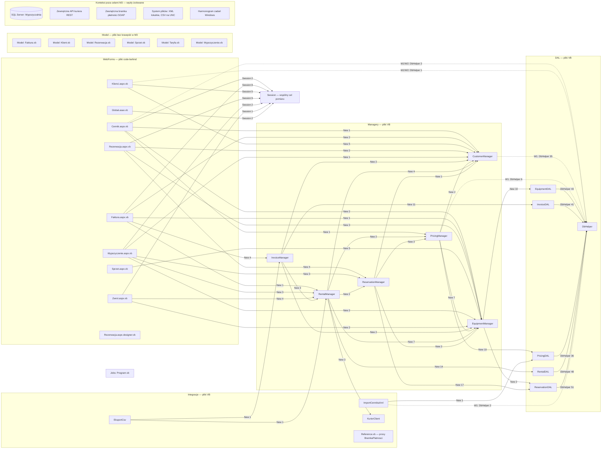

# Struktura i zależności aplikacji legacy

Zakres: `legacy-app-parent\legacy-app`, bez zmian w źródłach. Podstawą grafu jest wyłącznie macierz **M3**: `legacy-app-parent/analysis/results/04-POMIAR-STRUKTURY.md:72-109`. Klasyfikację odstępstw przyjęto z sekcji W1–W6: `legacy-app-parent/analysis/results/05-KLASYFIKACJA-WYJATKI.md:137-227`. Tabela w sekcji 3 rozszerza rozpoznanie o kod i konfigurację, ale **nie rozszerza zbioru krawędzi diagramu**.

## 1. Drzewo katalogów i role

Drzewo katalogów odpowiada M1, a role typów M2: `legacy-app-parent/analysis/results/04-POMIAR-STRUKTURY.md:5-70`. Nazwy plików w nawiasach są przykładami, nie dodatkowymi katalogami.

```text
legacy-app-parent\legacy-app\
├── Wypozyczalnia.sln, CZYTAJ.txt      — solucja i notatka wdrożeniowa
├── WypozyczalniaWeb\                 — interfejs ASP.NET WebForms, projekt i Web.config
│   ├── *.aspx, *.aspx.vb             — 7 stron: Cennik, Faktura, Klienci,
│   │                                  Rezerwacja, Sprzet, Wypozyczenie, Zwrot
│   ├── Rezerwacja.aspx.designer.vb   — deklaracje kontrolek projektanta
│   ├── Global.asax, Global.asax.vb   — cykl życia aplikacji i sesji
│   └── Web References\
│       └── BramkaPlatnosci\          — proxy Reference.vb i kontrakt WSDL SOAP
├── WypozyczalniaCore\                — biblioteka aplikacyjna i projekt .NET
│   ├── *Manager.vb                  — Customer, Equipment, Invoice,
│   │                                  Pricing, Rental, Reservation
│   ├── DAL\                         — DbHelper oraz 5 bram dostępu do danych
│   ├── Model\                       — Faktura, Klient, Rezerwacja, Sprzet,
│   │                                  Taryfa, Wypozyczenie i typ PozycjaFaktury
│   └── Integracje\                  — EksportCsv, ImportCennikaXml, KurierClient
├── Jobs\
│   └── EksportNocny\                — Program.vb, projekt .vbproj, harmonogram XML
└── Database\                        — 01_schema.sql, 02_procedury.sql, 03_seed.sql
```

Łącznie M1 obejmuje 52 pliki i 7713 linii fizycznych. Role nie oznaczają szczelnych granic warstw: przykładowo CustomerManager zawiera własny SQL i dostęp przez DbHelper (W1).

## 2. Graf zależności — wyłącznie M3

**Semantyka:** źródłem węzła jest plik VB, nie metoda. Etykieta `New n` oznacza liczbę dopasowań konstrukcji obiektu danego typu w pliku; `DbHelper n` i `Session n` oznaczają odpowiednie liczniki kolumn M3. Kierunek prowadzi od pliku używającego do typu/helpera albo do wspólnego węzła sesji. Licznik nie jest liczbą operacji biznesowych, żądań ani wykonań.

**Legenda:** linia ciągła oznacza zależność bez odstępstwa wskazanego dla niej w 05; przerywana oznacza W1 (DbHelper poza DAL) albo W1/W2 (DbHelper w stronie). Nie jest to ocena poprawności każdej metody. W3–W5 dotyczą reguł i obliczeń, a W6 ograniczeń rozpoznania użyć; nie tworzą krawędzi M3, więc nie dodano dla nich sztucznych połączeń.



Diagram zawiera wszystkie dodatnie komórki M3: 40 par dla `New`, 10 dla `DbHelper` i 7 dla `Session`, razem **57 skierowanych krawędzi**. Pięć z nich jest przerywanych. Osobne węzły stron i modeli o podobnych nazwach nie zostały utożsamione.

**Ograniczenie izolowanych węzłów:** M3 nie mierzy połączenia DbHelper → SQL Server, KurierClient → REST, Faktura → proxy SOAP → bramka, dostępu do plików ani relacji harmonogram → zadanie. Nie mierzy też konstruktorów EksportCsv i ImportCennikaXml jako celów. Dlatego Program.vb, proxy, modele i designer są izolowane w mierzonym grafie, a baza i systemy zewnętrzne są jedynie kontekstem bez krawędzi. Rzeczywiste przykłady tych zależności są w tabeli poniżej. Brak strzałki nie dowodzi braku zależności.

**M3 (`New` + `DbHelper` + `Session`) nie jest pełnym grafem aplikacji ani kolejnością runtime.** Strzałka do Session nie wskazuje innej strony ani kierunku przepływu danych między stronami. Graf nie obejmuje dziedziczenia, wszystkich wywołań metod, referencji projektowych ani przepływu sterowania.

## 3. Rodzaje zależności i dowody w repozytorium

Poniższe przykłady są celowo szersze niż M3. Dowody mają ścieżki względem korzenia repozytorium; separator `/` w odwołaniach jest formatem wymaganym przez `sprawdz_dowody.py`. Tabela nie implikuje, że zależności te są krawędziami sekcji 2.

| Rodzaj | Źródło → cel i znaczenie | Rzeczywisty dowód `repo/plik:linia` |
|---|---|---|
| kod | EquipmentManager tworzy EquipmentDAL; przykład relacji obecnej w M3. | `legacy-app-parent/legacy-app/WypozyczalniaCore/EquipmentManager.vb:23` |
| kod | Zadanie tworzy ImportCennikaXml i EksportCsv; tych celów konstruktorów M3 nie mierzy, więc Program pozostaje izolowany na diagramie. | `legacy-app-parent/legacy-app/Jobs/EksportNocny/Program.vb:62-63`; `legacy-app-parent/legacy-app/Jobs/EksportNocny/Program.vb:76-78` |
| referencja projektu | Projekt Web wskazuje projekt Core przez ProjectReference; nie jest to wywołanie runtime. | `legacy-app-parent/legacy-app/WypozyczalniaWeb/WypozyczalniaWeb.vbproj:137-140` |
| procedura | ReservationDAL przekazuje nazwę usp_SprawdzDostepnosc do helpera; istnieje definicja procedury w SQL, a helper wybiera CommandType.StoredProcedure. | `legacy-app-parent/legacy-app/WypozyczalniaCore/DAL/ReservationDAL.vb:18-21`; `legacy-app-parent/legacy-app/WypozyczalniaCore/DAL/DbHelper.vb:69-73`; `legacy-app-parent/legacy-app/Database/02_procedury.sql:27` |
| SQL | CustomerManager odczytuje Klienci bez odrębnego CustomerDAL — W1. Nie należy dodawać na tej podstawie strzałki do tabeli ani bazy w diagramie M3. | `legacy-app-parent/legacy-app/WypozyczalniaCore/CustomerManager.vb:17-19` |
| sesja | Klienci zapisuje WybranyKlientId, a Cennik odczytuje ten sam klucz; Global inicjalizuje stan. To współdzielony kontrakt nazwy i wartości, nie zmierzona krawędź strona → strona. | `legacy-app-parent/legacy-app/WypozyczalniaWeb/Klienci.aspx.vb:78`; `legacy-app-parent/legacy-app/WypozyczalniaWeb/Cennik.aspx.vb:104`; `legacy-app-parent/legacy-app/WypozyczalniaWeb/Global.asax.vb:22-23` |
| parametr adresu | Faktura czyta Request.QueryString("id"); Wypozyczenie czyta "rezerwacja". To kontrakty wejścia stron, nie dowód kolejności przejść między nimi. | `legacy-app-parent/legacy-app/WypozyczalniaWeb/Faktura.aspx.vb:68`; `legacy-app-parent/legacy-app/WypozyczalniaWeb/Wypozyczenie.aspx.vb:41` |
| konfiguracja | DbHelper wymaga connectionStrings/WypozyczalniaDb; Web.config wskazuje SQL Server i katalog Wypozyczalnia. | `legacy-app-parent/legacy-app/WypozyczalniaCore/DAL/DbHelper.vb:35`; `legacy-app-parent/legacy-app/WypozyczalniaWeb/Web.config:11-15` |
| konfiguracja | KurierClient czyta KurierApiUrl i KurierApiKey; proxy SOAP czyta BramkaPlatnosciUrl. Konfiguracja określa adresy, a nie dowodzi dostępności usług. | `legacy-app-parent/legacy-app/WypozyczalniaCore/Integracje/KurierClient.vb:22-25`; `legacy-app-parent/legacy-app/WypozyczalniaWeb/Web References/BramkaPlatnosci/Reference.vb:41`; `legacy-app-parent/legacy-app/WypozyczalniaWeb/Web.config:18-20` |
| system plików | Import ładuje XML z pliku; eksport zapisuje tekst CSV w kodowaniu 1250. Katalogi Web są w konfiguracji, a zadanie ma własne stałe ścieżek i przekazuje katalog eksportu jawnie. | `legacy-app-parent/legacy-app/WypozyczalniaCore/Integracje/ImportCennikaXml.vb:45`; `legacy-app-parent/legacy-app/WypozyczalniaCore/Integracje/EksportCsv.vb:76`; `legacy-app-parent/legacy-app/WypozyczalniaWeb/Web.config:21-22`; `legacy-app-parent/legacy-app/Jobs/EksportNocny/Program.vb:14-16`; `legacy-app-parent/legacy-app/Jobs/EksportNocny/Program.vb:78-81` |
| REST | KurierClient wysyła POST z JSON do skonfigurowanego API kuriera. To dowód implementacji klienta, nie ślad wykonania żądania. | `legacy-app-parent/legacy-app/WypozyczalniaCore/Integracje/KurierClient.vb:37-46`; `legacy-app-parent/legacy-app/WypozyczalniaCore/Integracje/KurierClient.vb:100-104` |
| SOAP | Faktura tworzy BramkaService i rejestruje płatność; proxy deklaruje metodę SOAP i wywołuje Invoke, WSDL podaje adres usługi. M3 nie odwzorowuje tych relacji. | `legacy-app-parent/legacy-app/WypozyczalniaWeb/Faktura.aspx.vb:225-228`; `legacy-app-parent/legacy-app/WypozyczalniaWeb/Web References/BramkaPlatnosci/Reference.vb:75-77`; `legacy-app-parent/legacy-app/WypozyczalniaWeb/Web References/BramkaPlatnosci/BramkaPlatnosci.wsdl:89` |
| harmonogram | Definicja Windows Task Scheduler przewiduje uruchamianie codziennie od 02:30 i uruchamia EksportNocny.exe z /tryb:pelny. Plik XML nie dowodzi zarejestrowania ani wykonania zadania na serwerze. | `legacy-app-parent/legacy-app/Jobs/EksportNocny/zadanie-harmonogramu.xml:10-16`; `legacy-app-parent/legacy-app/Jobs/EksportNocny/zadanie-harmonogramu.xml:39-41` |

## 4. Obserwacje z mierzonego grafu

### Metoda i liczność

Obliczenia wykonano z wierszy M3, nie z hipotez ani z pozostałych pomiarów 04. Dla każdego pliku utworzono węzeł, a dla każdej dodatniej wartości/licznika celu jedną skierowaną krawędź. Dodano wspólny cel Session. Nazwy stron i modeli zachowano jako osobne węzły. Otrzymano **33 węzły M3 wraz z Session i 57 krawędzi**. Pięć izolowanych węzłów otoczenia na rysunku nie wchodzi do tych statystyk. Wagi nie wpływają na stopień ani długość ścieżki.

### Cykle

Sprawdzenie przejść skierowanych z każdego węzła nie wykazało powrotu do węzła na bieżącej ścieżce: **graf M3 jest acykliczny** (brak również pętli własnych). Nie jest to dowód braku cykli w pełnej aplikacji: pomiar nie obejmuje wszystkich wywołań, a wspólna sesja jest modelowana jako ujście, nie jako połączenia między konsumentami.

### Huby

Stopień wejściowy to liczba różnych plików źródłowych, a wyjściowy — liczba różnych celów, nie suma wystąpień.

| Węzeł | Wejściowy | Wyjściowy | Interpretacja w M3 |
|---|---:|---:|---|
| DbHelper | 10 | 0 | Wspólny cel pięciu DAL i pięciu plików poza DAL; te ostatnie odpowiadają W1/W2. |
| EquipmentManager | 10 | 2 | Najczęściej współdzielony manager według liczby źródeł. |
| CustomerManager | 9 | 1 | Współdzielony manager z bezpośrednią zależnością od helpera — W1. |
| Session | 7 | 0 | Sześć stron i Global.asax.vb; nie wszystkie siedem stron używa Session w M3. |
| RentalManager | 5 | 6 | Największy stopień wyjściowy: sześć różnych celów konstruktorów. |
| Cennik.aspx.vb | 0 | 5 | Trzy managery, helper i sesja. |
| Faktura.aspx.vb | 0 | 5 | Cztery managery i sesja. |
| Wypozyczenie.aspx.vb | 0 | 5 | Cztery managery i sesja. |

Przykładowo `ReservationManager → ReservationDAL` ma wagę `New 17`, ale nadal jest jedną krawędzią. Liczniki DbHelper mogą obejmować tworzenie parametrów, a nie tylko wykonanie SQL. Porównywanie tych wag jako liczby transakcji byłoby nieuprawnione.

### Najdłuższa ścieżka

Dla acyklicznego grafu policzono długość od ujść rekurencją `L(v) = 0` dla ujścia, w pozostałych przypadkach `L(v) = 1 + max L(cel)`. Maksimum wynosi **7 krawędzi / 8 węzłów**, a nie liczbę managerów ani sumę liczników.

Przykład:

```text
Faktura.aspx.vb
→ InvoiceManager
→ RentalManager
→ ReservationManager
→ PricingManager
→ EquipmentManager
→ EquipmentDAL
→ DbHelper
```

Istnieją cztery ścieżki tej maksymalnej długości: źródłem może być `Faktura.aspx.vb` albo `EksportCsv.vb`, a przedostatnim węzłem `EquipmentDAL` albo `ReservationDAL`. Pozostały odcinek jest taki jak w przykładzie. Relacja EquipmentManager → ReservationDAL jest obecna w M3 z licznikiem 2, więc tego wariantu nie wolno pominąć.

**To ścieżki osiągalności między plikami, nie potwierdzony stos zagnieżdżonych wywołań.** Konstrukcje w jednym pliku mogą należeć do różnych metod, warunków i operacji biznesowych. Nie zmierzono wspólnego kontekstu wykonania kolejnych krawędzi. Wynik nie dowodzi również istnienia transakcji obejmującej tę ścieżkę ani nie wskazuje najdłuższego procesu biznesowego.

### Granice wnioskowania

W1/W2 pokazują rozszczelnienie granicy DAL mierzalne w M3. W3/W4 wskazują powielenie obliczeń i wartości, W5 rozbieżność komentarza z formułą, a W6 kandydatów bez dodatkowych wystąpień nazw metod. Żaden z tych pozostałych wyjątków nie uzasadnia dodatkowej krawędzi diagramu. Pełny graf wywołań, przepływ parametrów, rzeczywiste wykonanie integracji i stan wdrożenia pozostają poza tym pomiarem. Weryfikator dowodów sprawdza istnienie plików i linii, nie prawdziwość interpretacji.
