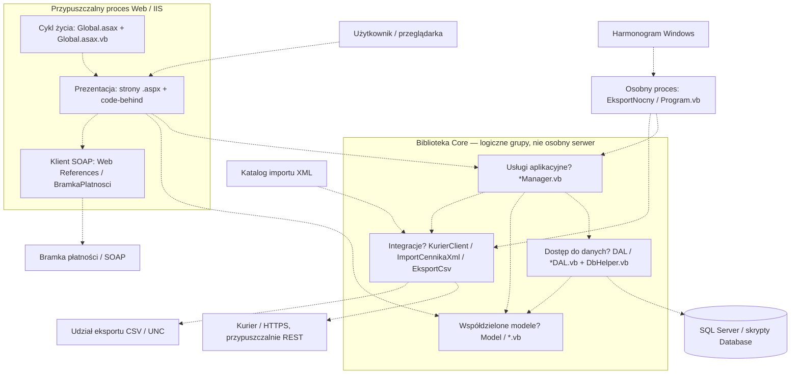

# Architektura legacy — hipoteza przed lekturą kodu

**Status: zamrożony zapis hipotez.** W kolejnych krokach nie poprawiać tego dokumentu; wyniki weryfikacji zapisywać osobno, odnosząc się do identyfikatorów H1–H14. Pewność oznacza subiektywną ocenę na podstawie ograniczonego materiału, nie wynik pomiaru statystycznego.

Podstawa: [pomiar CLOC](../results/01-POMIAR-CLOC.md), [stos technologiczny](../results/02-STOS-TECHNOLOGICZNY.md) oraz lista nazw plików i katalogów w `legacy-app-parent\legacy-app`. W tym kroku nie odczytywano treści plików implementacji ani ponownie konfiguracji legacy. Nie uruchamiano komend weryfikujących zamieszczonych poniżej. Nazwy klas, zależności wywołań i odpowiedzialności opisane na podstawie nazw plików pozostają hipotezami.

## 1) Typ aplikacji i pewność

**Hipoteza główna: klasyczna, serwerowa aplikacja biznesowa ASP.NET WebForms w VB.NET na .NET Framework 4.6.1, o organizacji warstwowej Web → Core → DAL → SQL Server, z osobnym procesem wsadowym i integracjami zewnętrznymi — 85%.**

Rozbicie oceny, aby nie utożsamiać technologii z faktycznym przepływem sterowania:

| Przypuszczenie | Pewność | Podstawa bez czytania implementacji |
|---|---:|---|
| Interfejs serwerowy WebForms, nie SPA. | 99% | Raport stosu, pary `.aspx` / `.aspx.vb`, `Global.asax`, projekt Web. |
| Aplikacja Web o charakterze monolitu, korzystająca z biblioteki Core w tym samym procesie. Nie jest to hipoteza „wszystko w jednym procesie”, bo istnieje także zadanie konsolowe. | 90% | Raport opisuje Web jako bibliotekę i referencję do projektu Core; brak osobnego hosta Core na liście plików. |
| Logiczny podział na prezentację, managery, dostęp do danych i modele. | 85% | Katalogi `WypozyczalniaWeb`, `WypozyczalniaCore\DAL`, `WypozyczalniaCore\Model` oraz pliki `*Manager.vb`. |
| Osobny proces wsadowy współdzieli Core z Web. | 95% | `Jobs\EksportNocny`, `Program.vb`, XML harmonogramu; raport opisuje referencję do DLL Core. Samo wywoływanie Core przez program pozostaje do sprawdzenia. |
| Granice warstw są przestrzegane bez wyjątków. | 35% | Sama organizacja katalogów tego nie dowodzi; code-behind i procedury SQL mogą zawierać logikę biznesową. |

Skala z raportu CLOC: **52 pliki, 6611 linii `code`, 7713 wszystkich linii**. Implementacja VB po wyłączeniu `.vbproj`: **32 pliki i 4825 linii `code`**; `.aspx.vb`: **7 plików i 1614 linii `code`**; SQL: **3 pliki i 563 linie `code`**. Nie jest to dowód proporcji odpowiedzialności: długość pliku nie rozstrzyga, gdzie leżą reguły.

## 2) Warstwy — diagram Mermaid

Każda przerywana strzałka to **hipoteza zależności lub przepływu**, nie odtworzony graf wywołań. Diagram nie określa granic transakcji ani kolejności operacji.



Biblioteka Core może być ładowana niezależnie do procesu Web i zadania; wspólny prostokąt na diagramie nie oznacza wspólnej pamięci. Alternatywy niewykluczone: SQL bezpośrednio w code-behind, wywołanie integracji przez stronę zamiast managera, logika w procedurach i operacje plikowe bezpośrednio w programie nocnym. Diagram pokazuje wariant roboczy, nie ukrywa tych możliwych odstępstw.

## 3) Kandydaci na wzorce

Globy są zapisem selektorów względem `legacy-app-parent\legacy-app` z separatorami Windows; `**` oznacza dowolne podkatalogi. To notacja analityczna, nie gotowe pathspecy Git.

| Nazwa wzorca / organizacji | Glob | Podstawa z nazw i katalogów | Pewność |
|---|---|---|---:|
| Page Controller / WebForms code-behind | `WypozyczalniaWeb\*.aspx`; `WypozyczalniaWeb\*.aspx.vb` | Strony i odpowiadające im pliki kodu: np. `Rezerwacja`, `Faktura`, `Zwrot`. Nie zakładamy MVC. | 95% |
| Architektura warstwowa | `WypozyczalniaWeb\*`; `WypozyczalniaCore\*Manager.vb`; `WypozyczalniaCore\DAL\*.vb`; `Database\*.sql` | Rozdzielone katalogi oraz powtarzalne sufiksy odpowiedzialności. Ścisłość kierunku zależności niepotwierdzona. | 85% |
| Service Layer / fasady przypadków użycia | `WypozyczalniaCore\*Manager.vb` | Sześć managerów nazwanych według obszarów: Customer, Equipment, Reservation, Rental, Pricing, Invoice. | 80% |
| DAO / wydzielony dostęp do danych | `WypozyczalniaCore\DAL\*DAL.vb` | Pięć plików z sufiksem DAL w osobnym katalogu. Nie nazywamy tego potwierdzonym Repository ani ORM. | 85% |
| Wspólny helper dostępu do bazy | `WypozyczalniaCore\DAL\DbHelper.vb` | Nazwa i położenie sugerują współdzielenie połączeń lub wykonywania poleceń. | 80% |
| Model danych / proste obiekty przenoszące dane | `WypozyczalniaCore\Model\*.vb` | Pliki `Klient`, `Sprzet`, `Rezerwacja`, `Wypozyczenie`, `Taryfa`, `Faktura`. Brak podstaw, by już mówić o bogatym modelu domenowym lub Active Record. | 65% |
| Proxy klienta SOAP | `WypozyczalniaWeb\Web References\BramkaPlatnosci\*` | Para `Reference.vb` i `BramkaPlatnosci.wsdl`; raport stosu opisuje generator proxy. | 95% |
| Adaptery integracyjne / import–eksport | `WypozyczalniaCore\Integracje\*.vb` | Nazwy `KurierClient`, `ImportCennikaXml`, `EksportCsv` sugerują różne granice systemu. Nie dowodzą wzorca Ports and Adapters dla całej aplikacji. | 85% |
| Proces wsadowy sterowany schedulerem | `Jobs\EksportNocny\*` | Osobny projekt, `Program.vb` i `zadanie-harmonogramu.xml`. | 95% |
| Transaction Script — kandydat, nie ustalenie | `WypozyczalniaCore\*Manager.vb`; `WypozyczalniaWeb\*.aspx.vb`; `Database\02_procedury.sql` | Nazwy operacyjnych managerów i procedur pasują do sekwencyjnej obsługi przypadków użycia, ale nie pokazują metod ani algorytmów. | 45% |

## 4) Moduły domenowe — mapowanie wyłącznie po nazwach

Nazwy w komórkach to pliki, nie potwierdzone klasy ani połączenia wywołań. Skróty katalogów: strona — `WypozyczalniaWeb`; manager — `WypozyczalniaCore`; DAL — `WypozyczalniaCore\DAL`; encja — `WypozyczalniaCore\Model`. „Encja” to robocza rola, nie stwierdzenie mapowania do tabeli. **BRAK** oznacza brak dedykowanego pliku o odpowiadającej nazwie w aktualnej liście, nie brak funkcji systemu.

| Moduł | Strona | Manager | DAL | Encja | Zastrzeżenie |
|---|---|---|---|---|---|
| Klienci | `Klienci.aspx` | `CustomerManager.vb` | **BRAK `CustomerDAL.vb` / `KlientDAL.vb`** | `Klient.vb` | Nie wiadomo, czy manager używa DbHelper bezpośrednio, innego DAL czy własnego SQL. |
| Sprzęt | `Sprzet.aspx` | `EquipmentManager.vb` | `EquipmentDAL.vb` | `Sprzet.vb` | Dopasowanie Equipment ↔ Sprzet jest semantyczne. |
| Rezerwacje | `Rezerwacja.aspx` | `ReservationManager.vb` | `ReservationDAL.vb` | `Rezerwacja.vb` | Najbardziej regularny łańcuch nazw, nadal bez potwierdzenia wywołań. |
| Wypożyczenia / wydania | `Wypozyczenie.aspx` | `RentalManager.vb` | `RentalDAL.vb` | `Wypozyczenie.vb` | Zakres operacji wydania nie wynika z samej nazwy. |
| Zwroty | `Zwrot.aspx` | **BRAK dedykowanego `ReturnManager.vb`**; kandydat: `RentalManager.vb` | **BRAK dedykowanego `ReturnDAL.vb`**; kandydat: `RentalDAL.vb` | **BRAK `Zwrot.vb`**; kandydat: `Wypozyczenie.vb` | Współdzielenie obsługi wypożyczenia i zwrotu jest hipotezą. |
| Cennik / taryfy | `Cennik.aspx` | `PricingManager.vb` | `PricingDAL.vb` | `Taryfa.vb` | Rabaty, VAT, kary i kolejność naliczania nie są ustalone. |
| Fakturowanie | `Faktura.aspx` | `InvoiceManager.vb` | `InvoiceDAL.vb` | `Faktura.vb` | Numeracja, pozycje i zależności od wypożyczenia nieznane. |
| Płatności | **BRAK `Platnosc.aspx`**; możliwy udział istniejącej strony, bez wskazania której | **BRAK dedykowanego managera płatności** | **BRAK dedykowanego DAL płatności** | **BRAK dedykowanego pliku płatności w Model** | Jest Web Reference bramki; nie oznacza to osobnego modułu UI. Notatka o stronie płatności, opisana w raporcie stosu, wymaga sprawdzenia. |

Import XML, eksport CSV i zadanie nocne traktujemy jako przekrojowe mechanizmy, a nie dodatkowe potwierdzone moduły domenowe. `DbHelper.vb` również nie jest automatycznym wypełnieniem brakujących komórek DAL.

## 5) Hipotezy H1–H14 i deterministyczna weryfikacja

**Procedura na później:** komendy PowerShell uruchamiać z korzenia repo. Każda odczytuje wyłącznie wskazany, ograniczony zbiór śledzonych plików, bez wykonywania aplikacji i SQL. `git grep -e '^'` jest celowo pełnym odczytem wybranych plików: samo trafienie słowa nie wystarcza do stwierdzenia zależności. Nie uruchomiono ich podczas tworzenia hipotezy.

Po odblokowaniu lektury kodu należy zapisać osobno: wynik komendy, deklaracje i ścieżkę wywołań oraz werdykt **potwierdzona / obalona / nierozstrzygnięta** według podanego kryterium. Kod wyjścia Git `1` oznacza brak dopasowań w śledzonych plikach, a nie automatycznie obalenie hipotezy; błąd komendy nie jest wynikiem analizy. Wywołania dynamiczne i zachowanie środowiska mogą wymagać dalszego badania. Nie deklarujemy, że analiza statyczna dowiedzie faktycznego wykonania w produkcji.

### H1 — strony korzystają z modelu zdarzeniowego WebForms — 95%

Hipoteza: code-behind dziedziczy po `Page` i obsługuje zdarzenia strony lub kontrolek.

```powershell
git --no-pager -C 'legacy-app-parent\legacy-app\WypozyczalniaWeb' grep -n -I -e '^' -- '*.aspx' '*.aspx.vb'
```

Kryterium: dopasować dyrektywy `Inherits` / `CodeBehind` stron do deklaracji klas; wskazać faktyczne powiązania handlerów, np. `Handles`, `OnClick` albo `AddHandler`, nie tylko nazwy metod. Brak powiązania w dostępnych plikach pozostawia część hipotezy nierozstrzygniętą.

### H2 — strony delegują operacje domenowe do managerów Core — 85%

Hipoteza: dla klientów, sprzętu, rezerwacji, wypożyczeń, cennika i faktur istnieją wywołania odpowiadających managerów z code-behind.

```powershell
git --no-pager -C 'legacy-app-parent\legacy-app\WypozyczalniaWeb' grep -n -I -e '^' -- 'Klienci.aspx.vb' 'Sprzet.aspx.vb' 'Rezerwacja.aspx.vb' 'Wypozyczenie.aspx.vb' 'Cennik.aspx.vb' 'Faktura.aspx.vb'
```

Kryterium: sporządzić sześć par strona → odbiorca wywołania i metoda, rozróżniając deklarację/import od wywołania. Jedna para niezgodna obala tezę o wszystkich sześciu, choć może potwierdzić częściowy wzorzec.

### H3 — pięć managerów ma zależności do odpowiadających im DAL — 85%

Hipoteza: Equipment, Reservation, Rental, Pricing i Invoice korzystają z DAL o tych samych prefiksach.

```powershell
git --no-pager -C 'legacy-app-parent\legacy-app\WypozyczalniaCore' grep -n -I -e '^' -- '*Manager.vb'
```

Kryterium: dla każdego z pięciu managerów wskazać wykonywane wywołanie jego DAL. Sama nazwa zmiennej, komentarz, import lub nieużywane pole nie potwierdzają hipotezy.

### H4 — DbHelper jest współdzielonym mechanizmem wykonywania SQL — 80%

Hipoteza: co najmniej dwa pliki `*DAL.vb` wywołują DbHelper, a helper tworzy połączenia lub wykonuje polecenia bazy.

```powershell
git --no-pager -C 'legacy-app-parent\legacy-app\WypozyczalniaCore\DAL' grep -n -I -e '^' -- '*.vb'
```

Kryterium: wskazać implementację operacji bazy w DbHelper i dwa różne pliki z faktycznymi wywołaniami. Mniej niż dwóch klientów nie spełnia tej wersji hipotezy.

### H5 — aplikacja wywołuje procedury ze skryptu SQL — 75%

Hipoteza: przynajmniej jedna procedura z `02_procedury.sql` ma odpowiadające wywołanie w VB.

```powershell
git --no-pager -C 'legacy-app-parent\legacy-app\Database' grep -n -I -e '^' -- '02_procedury.sql'
git --no-pager -C 'legacy-app-parent\legacy-app' grep -n -I -i -E 'CommandType|StoredProcedure|CommandText|Execute|exec[[:space:]]|usp_|dbo\.' -- '*.vb'
```

Kryterium: zestawić nazwę zadeklarowanej procedury z nazwą faktycznie przekazywaną do wykonania i sposobem wywołania. Prefiks `usp_` jest tylko pomocniczym tropem; gdy nazwa powstaje dynamicznie albo polecenie jest rozbite na linie, prześledzić pełny blok odpowiedniego pliku. Brak trafień tego selektora nie wystarcza do obalenia.

### H6 — obsługa klientów omija dedykowany CustomerDAL — 65%

Hipoteza: CustomerManager sam inicjuje dostęp do bazy przez DbHelper lub API SQL, zamiast delegować całość do innego DAL.

```powershell
git --no-pager -C 'legacy-app-parent\legacy-app\WypozyczalniaCore' grep -n -I -e '^' -- 'CustomerManager.vb'
```

Kryterium: znaleźć wywołanie helpera/SQL w wykonywalnej metodzie i ustalić odbiorcę. Delegowanie wyłącznie do innego komponentu dostępu do danych obala tę wersję hipotezy. Brak pliku CustomerDAL sam w sobie jej nie potwierdza.

### H7 — wypożyczenie i zwrot współdzielą RentalManager — 80%

Hipoteza: oba code-behind korzystają z RentalManager; nie ma osobnego przepływu zwrotu omijającego go całkowicie.

```powershell
git --no-pager -C 'legacy-app-parent\legacy-app\WypozyczalniaWeb' grep -n -I -e '^' -- 'Wypozyczenie.aspx.vb' 'Zwrot.aspx.vb'
```

Kryterium: wskazać wywołanie RentalManager związane z wydaniem oraz wywołanie związane ze zwrotem. Wspólne użycie modelu `Wypozyczenie` bez managera nie wystarcza.

### H8 — istotne reguły cenowe są skupione w PricingManager — 60%

Hipoteza: PricingManager zawiera obliczenie ceny lub rabatu, a nie wyłącznie pobieranie i zapisywanie taryf.

```powershell
git --no-pager -C 'legacy-app-parent\legacy-app\WypozyczalniaCore' grep -n -I -e '^' -- 'PricingManager.vb'
git --no-pager -C 'legacy-app-parent\legacy-app\WypozyczalniaWeb' grep -n -I -e '^' -- 'Cennik.aspx.vb'
```

Kryterium: wskazać wejścia, działanie matematyczne lub warunek biznesowy oraz wynik wyliczenia w managerze. Sama metoda odczytu cennika nie potwierdza hipotezy; reguła wyłącznie w UI lub SQL obala tezę o jej obecności w tym managerze. Nie zakładamy kompletności centralizacji.

### H9 — modele są przede wszystkim obiektami danych — 65%

Hipoteza: sześć typów z katalogu Model nie wykonuje I/O; służy do przenoszenia stanu domenowego.

```powershell
git --no-pager -C 'legacy-app-parent\legacy-app\WypozyczalniaCore\Model' grep -n -I -e '^' -- '*.vb'
```

Kryterium: sklasyfikować wszystkie pola, właściwości i metody sześciu typów. Wywołanie SQL, sieci lub plików w dowolnym z nich obala tezę o braku I/O; delegację do zewnętrznego helpera trzeba prześledzić przed werdyktem. Brak I/O nie oznacza automatycznie braku logiki domenowej.

### H10 — code-behind bezpośrednio inicjuje płatność SOAP — 55%

Hipoteza: co najmniej jedna z istniejących stron wywołuje wygenerowane proxy bramki; nie zakładamy istnienia `Platnosc.aspx`.

```powershell
git --no-pager -C 'legacy-app-parent\legacy-app\WypozyczalniaWeb' grep -n -I -e '^' -- '*.aspx.vb'
git --no-pager -C 'legacy-app-parent\legacy-app\WypozyczalniaWeb\Web References\BramkaPlatnosci' grep -n -I -e '^' -- 'Reference.vb'
```

Kryterium: powiązać konkretną instancję/typ proxy i wywołanie jego operacji z handlerem strony. Import przestrzeni nazw ani samo istnienie proxy nie wystarcza; wywołanie wyłącznie przez inną warstwę obala wariant „bezpośrednio”.

### H11 — KurierClient izoluje komunikację HTTP z kurierem — 85%

Hipoteza: KurierClient buduje lub wysyła żądanie HTTP, zamiast być wyłącznie modelem danych.

```powershell
git --no-pager -C 'legacy-app-parent\legacy-app\WypozyczalniaCore\Integracje' grep -n -I -e '^' -- 'KurierClient.vb'
```

Kryterium: wskazać adres, sposób utworzenia żądania, metodę HTTP i miejsce wysłania albo bezpośrednią delegację do klienta HTTP. Format danych, autoryzację i obsługę błędów zapisać jako osobne ustalenia; sama nazwa klasy nie potwierdza komunikacji.

### H12 — import i eksport realizują adaptery plikowe — 85%

Hipoteza: ImportCennikaXml odczytuje XML, a EksportCsv zapisuje CSV; nie są to wyłącznie funkcje przekształcające dane już obecne w pamięci.

```powershell
git --no-pager -C 'legacy-app-parent\legacy-app\WypozyczalniaCore\Integracje' grep -n -I -e '^' -- 'ImportCennikaXml.vb' 'EksportCsv.vb'
```

Kryterium: wskazać operację odczytu pliku i parsowania XML oraz operację zapisu pliku i serializacji CSV. Samo zwracanie tekstu CSV lub przyjmowanie gotowego dokumentu XML potwierdziłoby tylko część tej hipotezy.

### H13 — program nocny orkiestruje import i eksport przez Core — 90%

Hipoteza: ścieżka `/tryb:pelny` uruchamia oba adaptery Core, a nie tylko jeden z nich.

```powershell
git --no-pager -C 'legacy-app-parent\legacy-app\Jobs\EksportNocny' grep -n -I -e '^' -- 'Program.vb'
```

Kryterium: prześledzić argument od punktu wejścia do wywołań importu i eksportu; ustalić warunki oraz kolejność. Jeśli program deleguje do innej metody, dalsze sprawdzenie jej implementacji jest konieczne. Opis zadania i referencja DLL nie zastępują ścieżki wywołań.

### H14 — część reguł biznesowych leży w procedurach SQL — 65%

Hipoteza: przynajmniej jedna procedura zawiera decyzję biznesową, nie tylko techniczny CRUD.

```powershell
git --no-pager -C 'legacy-app-parent\legacy-app\Database' grep -n -I -e '^' -- '02_procedury.sql'
```

Kryterium: wskazać konkretny warunek lub obliczenie zależne od pojęć domenowych, np. statusu, terminu, dostępności albo kwoty, oraz jego skutek. Samo `IF`, obsługa błędu technicznego lub `BEGIN TRAN` nie spełniają kryterium. Brak reguł w tym pliku obala tę wąską hipotezę, lecz nie dowodzi braku reguł w działającej bazie poza repozytorium.

## 6) Czego nie wiemy

- Czy nazwy plików odpowiadają deklaracjom typów, a kandydaci z tabeli modułów rzeczywiście ze sobą współpracują.
- Czy warstwowość jest konsekwentna: UI może wykonywać SQL, managery mogą odwoływać się do innych managerów, a integracje mogą być wywoływane bezpośrednio przez strony.
- Gdzie kończy się walidacja UI, a zaczynają reguły biznesowe; zwłaszcza gdzie są rabaty, VAT, kary, dostępność i numeracja faktur.
- Czy reguły są zdublowane w code-behind, managerach i procedurach; wielkość plików tego nie rozstrzyga.
- Gdzie przebiegają transakcje, jak działa współbieżność i czy istnieje ochrona przed podwójną rezerwacją, zwrotem lub płatnością.
- Jaki jest model stanów rezerwacji, wypożyczenia, faktury i płatności oraz dozwolone przejścia.
- Jak wygląda rzeczywisty schemat relacyjny: klucze, relacje, ograniczenia i obiekty bazy niewidoczne w nazwach plików.
- Czy modele to DTO, encje z zachowaniem czy obiekty mieszane; nazwa katalogu Model nie rozstrzyga.
- Kto wywołuje płatności i kuriera, kiedy następują skutki zewnętrzne, jak działają retry, timeouty, idempotencja i uzgadnianie statusów.
- Jak program nocny pozyskuje konfigurację, definiuje „poprzedni dzień”, reaguje na błędny plik i częściowe niepowodzenie oraz czy można go bezpiecznie ponowić.
- Jakie dane przechowywane są w sesji lub stanie strony, czy jest cache oraz jakie skutki ma restart procesu Web.
- Czy CsvHelper jest używany, nieużywany czy ładowany pośrednio; raport wykazuje brak jawnej referencji, nie rozstrzyga działania.
- Jakie są faktyczne wersje serwera SQL i IIS, bindingi HTTP/TLS, konta procesów, uprawnienia i topologia wdrożenia.
- Czy istnieją testy lub dodatkowe komponenty poza zinwentaryzowanym drzewem; brak ich nazw w tym zakresie nie dowodzi globalnego braku.

**Zasada dalszej pracy:** wyniki lektury kodu mogą obalić dowolną hipotezę. Dopisywać je do osobnego dokumentu weryfikacyjnego, nie aktualizować tej zamrożonej wersji pod poznaną później implementację.
